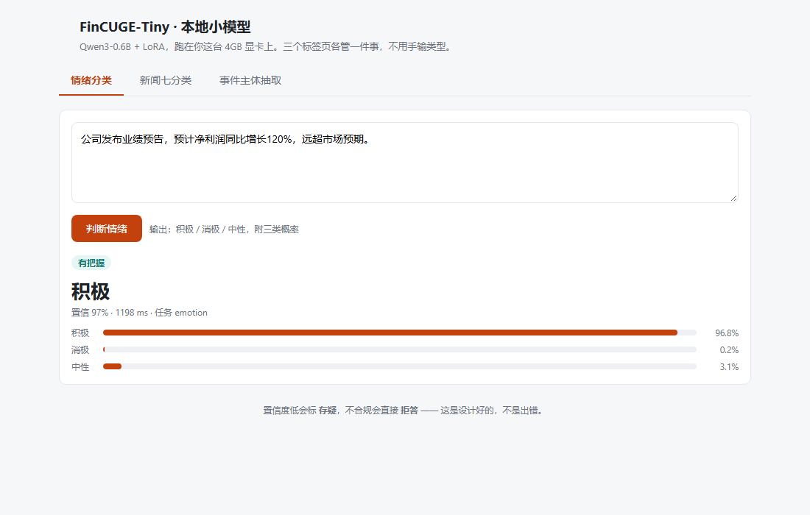
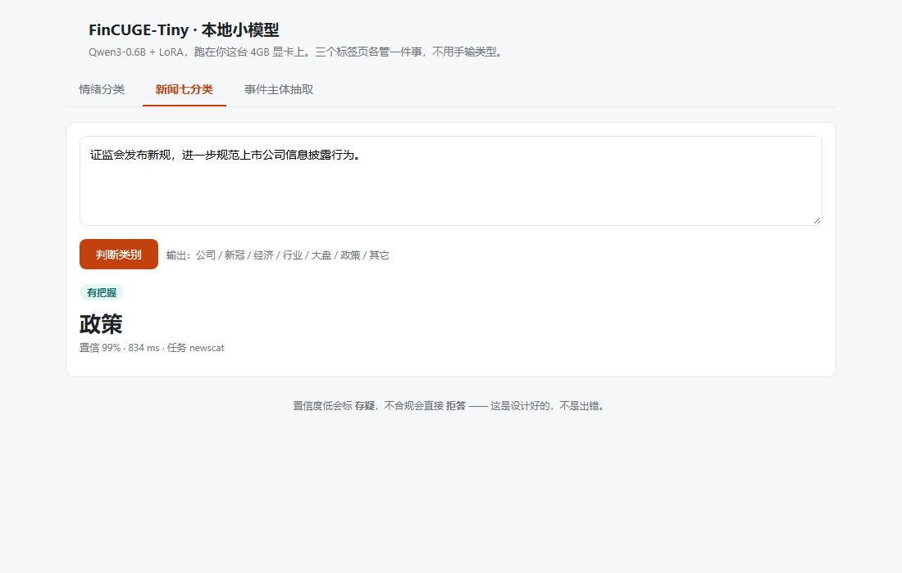
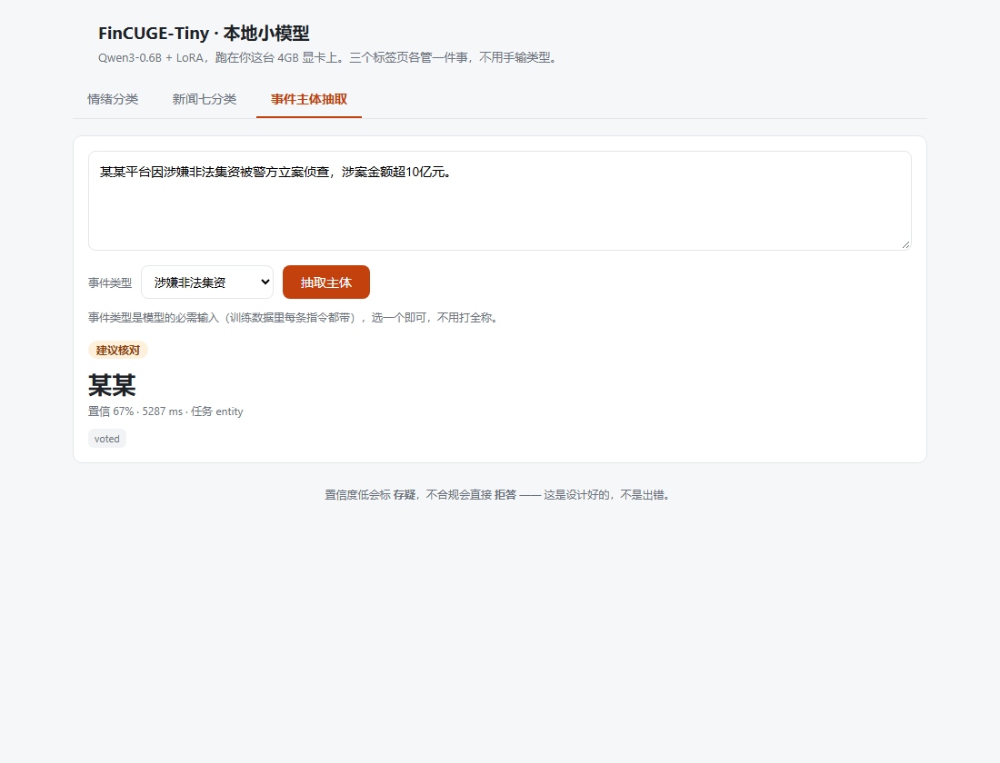

# FinCUGE-Tiny

把 Qwen3-0.6B 用 LoRA 微调，做三个中文金融任务：情绪三分类、新闻七分类、从新闻里抽事件主体。

训练全部在一块 GTX 1650（4GB）上完成，每个任务训一轮，峰值显存 1.55GB，单任务不超过 3 小时。

  


数据来自 FinCUGE 的指令化版本。三个任务都在全量评估集上评测，基座用同一套判分代码跑同一批样本，所以可以直接对比。

## 更新

- **2026-10-29** 三个任务跑完；补上 agent harness（路由 + 校验 + 拒答）。主体抽取 1,464 条测试里没有一次编造公司名。
- **2026-10-28** 情绪用 16,157 条全量重训，原答案句式版 75.2%；把答案压成只有标签词的 Verbalizer 版 76.3%，随仓库发布的是后者。
- **2026-10-27** 新闻七分类 89.7%，零样本基座 26.4%。

## 结果

| 任务     | 指标       | 基座（零样本） | 微调后      | 提升    | 评估集   | 训练时长    |
| ------ | -------- | ------- | -------- | ----- | ----- | ------- |
| 情绪三分类  | Accuracy | 48.3    | **76.3** | +28.0 | 2,020 | 169 min |
| 新闻七分类  | Accuracy | 26.4    | **89.7** | +63.3 | 884   | 179 min |
| 事件主体抽取 | 实体严格匹配   | 0.5     | **86.1** | +85.6 | 1,464 | 190 min |

新闻分类的准确率是零样本基座的 3.4 倍。三项指标的口径与公开论文不同（数据版本、训练方式都不一样），所以没有跟论文数字横比。

## 和公开报告的对照

三个任务在同一份公开中文金融基准（Golden Touchstone，用的也是 FinCUGE 这批数据）里都有数字，放在一起看。

**先说不等价的四处**，不然这表会误导人：

1. **切片不同**：公开报告用 test（2,020 / 884 / 1,782），我们用 valid（2,020 / 884 / 1,464）。规模接近，但样本不是同一批
2. **新闻类别数不同**：公开报告是 **15 类**，我们是 **7 类**（长尾合并），难度不一样
3. **训练方式不同**：公开表里的模型都是**零样本**，我们是在同一任务上**微调**过的
4. 公开模型的推理模板由原作者各自调过，我们只用自己的一套

下面三组条形按同一刻度画（0 到 0.95），越长越好；只作量级参考，不宣称胜负。

### 情绪三分类 · FinFE-CN · Weighted-F1

```
Touchstone-GPT       7B    ███████████████░░░  0.789  金融预训练 + 指令微调
本项目 Qwen3-0.6B    0.6B  ██████████████░░░░  0.754  LoRA / 4GB 显卡  ← 我们
GPT-4o               N/A   ████████████░░░░░░  0.659  零样本
Qwen2-7B-Instruct    7B    ████████████░░░░░░  0.627  零样本
DISC-FinLLM          13B   ████████░░░░░░░░░░  0.418  金融指令微调
Llama-3-8B-Instruct  8B    ███████░░░░░░░░░░░  0.363  零样本
CFGPT1-7B            7B    █████░░░░░░░░░░░░░  0.253  金融继续预训练
```

三类 F1：积极 0.837 / 消极 0.779 / 中性 0.597。中性仍是短板，根因是标注噪声（同一段文本被标不同标签的占 9.6%），不是模型结构问题。

### 新闻分类 · FinNL-CN · ORMACC

```
Touchstone-GPT       7B    ████████████████░░  0.836  15 类，金融预训练 + 微调
本项目 Qwen3-0.6B    0.6B  █████████████████░  0.897  7 类  ← 类别数不同，不可比
GPT-4o               N/A   ██████░░░░░░░░░░░░  0.330  15 类，零样本
CFGPT1-7B            7B    ██░░░░░░░░░░░░░░░░  0.089  15 类，金融继续预训练
Llama-3-8B-Instruct  8B    █░░░░░░░░░░░░░░░░░  0.075  15 类，零样本
Qwen2-7B-Instruct    7B    █░░░░░░░░░░░░░░░░░  0.062  15 类，零样本
DISC-FinLLM          13B   ░░░░░░░░░░░░░░░░░░  0.001  15 类，金融指令微调
```

**这组不能横比**：我们只有 7 个类别，公开是 15 个，长尾全并进"其它"，天然容易得高分。要严格比较，得把 15 类重训一遍，还没做。

### 事件主体抽取 · FinESE-CN · ORMACC

```
Touchstone-GPT       7B    █████████████████░  0.907  金融预训练 + 指令微调
本项目 Qwen3-0.6B    0.6B  ████████████████░░  0.861  LoRA / 4GB 显卡  ← 我们
GPT-4o               N/A   █████████████░░░░░  0.687  零样本
DISC-FinLLM          13B   ████████░░░░░░░░░░  0.435  金融指令微调
CFGPT1-7B            7B    ███████░░░░░░░░░░░  0.386  金融继续预训练
Qwen2-7B-Instruct    7B    ███████░░░░░░░░░░░  0.368  零样本
Llama-3-8B-Instruct  8B    ██████░░░░░░░░░░░░  0.309  零样本
```

### 合起来能说明什么

- 在**情绪**和**主体抽取**上，0.6B + 微调超过了 GPT-4o 的零样本成绩（0.754 vs 0.659、0.861 vs 0.687），而且不是一个量级的成本
- **7B 金融专用模型（Touchstone-GPT）仍然更高**（0.789 / 0.907），说明领域预训练 + 更大参数依然有用，我们没到顶
- **新闻分类不具备可比性**，别引用这一栏的"我们更高"
- 一句话：0.6B + 4GB 显卡 + 3 小时训练，在两个任务上进入 7B 金融专用模型的邻居区、超过 GPT-4o 零样本；但评估切片、训练方式、类别数都不同，**这不等于"击败"**

## 预训练权重

三个 adapter 放在 [Releases v0.1.0](https://github.com/zhangyh066/fincuge-tiny/releases/tag/v0.1.0)，共 58MB，下载后不用重训就能用：

| 文件 | 任务 | 评估结果 |
|---|---|---|
| `emotion_adapter.safetensors` + `emotion_adapter_config.json` | 情绪三分类 | 2,020 条上 76.3% |
| `newscat_adapter.safetensors` + `newscat_adapter_config.json` | 新闻七分类 | 884 条上 89.7% |
| `entity_adapter.safetensors` + `entity_adapter_config.json` | 事件主体抽取 | 1,464 条上 86.1% |

两个文件放进同一个目录（比如 `weights/entity/`），然后直接指过去：

```
python eval_entity.py --adapter weights/entity
```

`harness.py` 会自动在 `weights/{emotion,newscat,entity}` 下找权重，放好了就能直接用：

```python
from harness import Harness

h = Harness()
h.answer("这家公司业绩暴雷，投资者情绪一片悲观")
```

只想自己训练的话可以跳过这一节，脚本会从零训出同样的 adapter。

## 安装

```
pip install -r requirements.txt
```

torch 要按本机 CUDA 版本装，例如 `pip install torch==2.7.1 --index-url https://download.pytorch.org/whl/cu118`。

基线模型默认读 `D:/ai/models/Qwen3-0.6B`，本地没有就自动从 HuggingFace 拉 `Qwen/Qwen3-0.6B`；也可以用环境变量 `QWEN_MODEL` 指定别的路径。

## 快速开始

数据就在仓库里，以情绪任务为例，两条命令跑完训练和评估：

```
python train_sft.py --data_path data/fincuge/emotion_train.json --num_samples 16157 \
  --seq_len 128 --batch_size 2 --grad_accum 4 --epochs 1 --fast_loss 1 \
  --out out/adapter-emotion
python eval_verbalizer.py --limit 0 --adapter out/adapter-emotion --batch 4
```

在 4GB 卡上，训练大约 2 小时 50 分，评估 8 分钟。训练结束会得到三个目录：`out/adapter-emotion` 是最后一轮，`out/adapter-emotion_best` 是验证集上最好的那一轮，`out/adapter-emotion_ckpt` 是中途断点。

另外两个任务把数据换掉、评估脚本换掉就行，命令在下面各自的段落里。

## 数据

`data/fincuge/` 下共约 15MB，已经转成 alpaca 三字段格式，clone 下来可以直接训，不用另外下载数据集。

| 任务 | 训练集 | 评估集 | 数据文件 |
|---|---|---|---|
| 情绪三分类 | 16,157 | 2,020 | `emotion_train.json` / `emotion_eval.json` |
| 情绪（Verbalizer 版） | 16,157 | 2,020 | `emotion_vb_train.json` / `emotion_vb_eval.json` |
| 新闻七分类 | 7,071 | 884 | `newscat7_train.json` / `newscat7_eval.json` |
| 事件主体抽取 | 11,752 | 1,464 | `entity_train.json` / `entity_eval.json` |

```json
{
  "instruction": "判断以下句子的情感属性。",
  "input": "该公司一季度净利润同比增长三成。",
  "output": "积极"
}
```

这些文件由 FinCUGE 原始数据转换而来，版权归 BBT-Fin / FinCUGE 原项目，放在这里只为便于复现，请遵循原项目许可，勿作商用。需要从原始数据重做时再执行 `prepare_fincuge.py` 和 `prepare_newscat7.py`。

早期筛选数据时用过的第三方语料（LIMA、COIG-PC、CAIL2018、中文 Alpaca 51k）没放进仓库，各自的下载地址见 [data/SOURCES.md](data/SOURCES.md)。

## 三个任务

### 情绪三分类

训练 16,157 条，评估 2,020 条（积极 886 / 消极 574 / 中性 560）。

|                                                                                                                              |                                                 |
| ---------------------------------------------------------------------------------------------------------------------------- | ----------------------------------------------- |
| 这份数据的答案有 15 种句式（"积极。"、"该文本情感是积极的。"……），生成文本再解析容易踩格式的坑。这里改成直接读三个标签 token 的概率：一次前向拿到 P(积极)、P(消极)、P(中)，再把"中"接到输入末尾补一次得到 P(性 | 中)，两者相乘就是 P(中性)，最后在三类内归一化。评估只要一次前向，置信度也顺便有了。 |

```
python train_sft.py --data_path data/fincuge/emotion_train.json --num_samples 16157 \
  --seq_len 128 --batch_size 2 --grad_accum 4 --epochs 1 --fast_loss 1 \
  --out out/adapter-emotion
python eval_verbalizer.py --limit 0 --adapter out/adapter-emotion --batch 4
```

另外做了一个对照：把答案压成只剩"积极/消极/中性"再训一版（`emotion_vb_train.json`），得 76.3%，只高 1.1 个百分点，在噪声范围内。瓶颈不在答案格式。

### 新闻七分类

训练 7,071 条，评估 884 条。

原始 FinCUGE 是 15 类，这里用 `prepare_newscat7.py` 并成 7 类：公司、新冠、经济、行业、大盘、政策、其它。生成式输出，答案解析时按类别词的别名匹配（"个股"算公司，"疫情"算新冠）。

```
python prepare_newscat7.py
python train_sft.py --data_path data/fincuge/newscat7_train.json --num_samples 7071 \
  --seq_len 512 --batch_size 2 --grad_accum 4 --epochs 1 --fast_loss 1 \
  --out out/adapter-newscat
python eval_multi.py --task newscat7 --adapter out/adapter-newscat
```

### 事件主体抽取

训练 11,752 条，评估 1,464 条。

这是生成任务：答案是一句话加一个主体（"所属信批违规事件的金融主体是××。"），训练集有 103 种模板。评估时从生成文本里抽出主体（规则是取最后一个"是"或"："之后的内容、去标点），再跟金标比实体。

```
python train_sft.py --data_path data/fincuge/entity_train.json --num_samples 11752 \
  --seq_len 320 --batch_size 2 --grad_accum 4 --epochs 1 --fast_loss 1 \
  --out out/adapter-entity --val_metric entity --val_limit 200
python eval_entity.py --adapter out/adapter-entity
```

严格匹配 86.1%，宽松匹配 89.2%（允许"雅虎"对"雅虎公司"），实体级 P/R/F1 都是 0.861。203 条错例里，78% 是原文里有好几个公司名、挑中了错的那个，22% 是多一个字少一个字（`科融环境` 抽成 `万科融环境`）。

1,464 条测试里，模型预测的主体全部出现在原文中，没有一条是编造的。

## Agent harness

三个 adapter 可以挂在同一个基座上，由一个外壳调度：判断该用哪个技能，按固定模板调用，校验输出，没把握就说不知道。

```
输入 → 清洗 → 路由 → 技能执行 → 校验 → 三档判定 → 输出
                     ↑               ↓
                     └─── 重试（最多 2 次）───┘
```

```python
from harness import Harness

h = Harness()
h.answer("这家公司业绩暴雷，投资者情绪一片悲观")
# {'task': 'emotion', 'answer': '消极', 'confidence': 0.922,
#  'decision': 'auto', 'flags': [], 'latency_ms': 1047}
```

三个 adapter 同时驻留（每个 LoRA 约 10MB），切换不重载。端到端延迟：情绪约 1.0s、新闻约 0.8s、主体抽取约 1.2~1.4s。

| decision  | 含义      | 触发条件             |
| --------- | ------- | ---------------- |
| `auto`    | 直接采用    | 校验通过且置信度 ≥ 阈值    |
| `hint`    | 给出但标注存疑 | 置信度中等，或存在非致命瑕疵   |
| `abstain` | 拒答并说明原因 | 标签非法、实体为空、实体不在原文 |

**网页版（推荐）**：三个标签页分别对应情绪、新闻分类、主体抽取，不用手选任务类型；实体页在下拉里选事件类型即可。

```bash
# Windows：双击 start_webui.bat，或
python webui.py
# Linux / macOS
python webui.py --port 7860
```

浏览器打开 `127.0.0.1:7860`。纯标准库实现，不依赖 gradio / streamlit；模型只在启动时加载一次。







**命令行版**：`python harness.py --chat`，敲文本回车，看任务、答案、置信度和决策。

每次调用写一行日志到 `logs/harness_trace.jsonl`，含路由依据、置信度、决策、flags、耗时。设计细节见 [AGENT\_HARNESS.md](AGENT_HARNESS.md)。

### 实体任务的自一致性投票

主体抽取有一个额外手段：置信度低时再采样 2 次、三次投票。它只在这个任务上开，因为只有生成式才有采样空间。

200 条随机样本上的实测：

| 触发阈值 | 触发比例 | 准确率 | 平均生成次数 |
|---|---|---|---|
| 不投票（greedy） | — | 89.0% | 1.00× |
| 0.85 | 8% | 89.5% | 1.17× |
| **0.88** | **33%** | **91.0%** | **1.66×** |
| 0.89 | 52% | 91.0% | 2.05× |
| 0.92 | 100% | 91.0% | 2.99× |

甜点在 **0.88**：触发三分之一请求就拿满 +2.0 个点，再往上调阈值只增加成本、不再涨分。投票期间救回 5 条、坑掉 1 条；低置信那 52% 的片段提升更明显（81.9% → 85.7%）。

两点说明：

- 这张表的基线 89.0% 只对这 200 条成立（全量 1,464 条是 86.1%），看增量不要看绝对值
- 投票后的置信度改用"一致度"（3 次全一致 1.0、2 次一致 0.67），和 token 概率不是一个尺度，判定阈值也另算一套

## 为什么能塞进 4GB

三件事一起做才够：

| 手段                | 效果                              |
| ----------------- | ------------------------------- |
| 只对答案 token 算 loss | lm_head 不再输出整段序列，省约 600MB       |
| LoRA r=8，挂 7 个模块  | 可训练参数 0.84%，优化器状态只占几 MB         |
| 序列长度按数据 P99 定     | 主体抽取 P99 只有 201 token，不必按 512 跑 |

配合 batch 2、梯度累积 4、梯度检查点，稳定跑在 1.55GB。实现上主要在 `train_sft.py` 的 `answer_only_loss()` 和 `--fast_loss` 开关。

## 目录结构

```
.
├── train_sft.py         # 训练：LoRA + 只对答案算 loss + 梯度累积 / 检查点
├── prompt_util.py       # 提示词拼装的唯一真源
├── eval_verbalizer.py   # 情绪评估：受限 softmax
├── eval_multi.py        # 新闻评估：生成式 + 标签别名解析
├── eval_entity.py       # 主体抽取评估：抽实体 + 严格 / 宽松匹配 + F1 + 幻觉率
├── harness.py           # Agent 外壳：路由 + 校验 + 三档判定 + 日志
├── calibrate.py         # 阈值标定：覆盖率-准确率曲线
├── tests/               # 路由回归测试（24 条，不加载模型，秒级）
├── data/fincuge/        # 三个任务的数据（约 15MB）
└── assets/results.svg   # 结果图
```

## 文档

- [从零微调教程](docs/教程-从零微调.md)：从装环境到训练、评估、封成 agent，每步都有命令和"该看到什么"
- [Agent harness 设计](AGENT_HARNESS.md)：六层结构、校验规则、阈值定法、重试策略
- [对标成熟方案与提升空间](docs/agent-对标与提升.md)：级联决策、约束解码、置信度校准，以及我们还差什么
- [数据来源](data/SOURCES.md)：仓库内的数据和没放进来的第三方语料各来自哪里

## 我们改了什么

分四块，每块都标了效果；最后一块是**试过但被数据否掉**的方向。

### 训练侧

| 改动 | 效果 |
|---|---|
| 只对答案 token 算 loss | lm_head 不再输出整段序列，省约 600MB，4GB 卡才跑得起来 |
| LoRA r=8 挂 7 个模块 | 可训练参数 0.84%（5.05M / 601M），优化器状态只占几 MB |
| 序列长度按数据 P99 定 | 实体 P99=201，用 320 而不是 512：省三分之一时间，只丢 27 条（0.23%） |
| 单轮训练 | 第二轮开始过拟合（验证集掉、训练 loss 继续降） |
| 提示词唯一真源 | 修掉"训练用 `\n`、评估用 `\n\n文本：`"的历史不一致，这类错会系统性压低 5~10 个点 |

### 评估侧

| 改动 | 效果 |
|---|---|
| 受限 softmax 评估情绪 | 一次前向读三类概率，450 → 229 ms/条，顺带得到置信度 |
| 实体四口径 | 严格匹配 / 宽松匹配 / 实体级 P-R-F1 / 幻觉率；幻觉率 0% 是这份结果里最有价值的一条 |
| 断点续跑 | 结果逐批落盘，被系统掐断后重跑同一条命令自动接着来 |

### 外壳侧

| 改动 | 效果 |
|---|---|
| 关键词路由 + 24 条回归集 | 实测 81.8% → 100%，`tests/test_routing.py` 秒级可跑 |
| 三档判定 + 阈值标定 | 情绪 0.90/0.50、新闻 0.95/0.50、实体 0.89/0.79，全部来自覆盖率-准确率曲线 |
| 自一致性投票 | 实体任务置信度 <0.88 时采样 3 次投票，200 条 +2.0pp，成本 1.66 倍 |
| 校验分「拦截 / 提醒」两级 | 公司名带括号曾被当成标点违规误拒，改分级后自检从 49/50 回到 50/50 |
| 输入长度保护 | 超过 448 token 自动截断并打 `input_truncated`，不再静默超长 |
| 单行 trace | 每次调用记录路由依据、置信度、决策、flags、耗时，出问题能定位到哪一步 |

### 前端

网页版不是简单包一层输入框，几个设计选择都是有原因的：

| 设计 | 为什么这么做 |
|---|---|
| **三个标签页**，而不是一个输入框自动判断 | 用户不用记任务名，也不用猜"它会不会判错任务"。标签页直接把任务固定下来，页面调接口时显式传 task_hint；关键词路由仍然留在 API 和命令行版里 |
| 实体页把**事件类型做成下拉**（12 个高频类型 + 其它手填） | 实体的训练指令里带事件类型（121 种），不给就是分布外输入，模型会答到原文之外。下拉既保证输入合法，又不用手打整句 |
| 结果卡片**三种颜色**：绿=有把握、黄=建议核对、红=拒答 | 直接映射 harness 的三档判定，不让用户去理解"置信度 0.67 意味着什么" |
| 情绪页画**三条概率条** | 能看出模型是不是在犹豫（比如 0.51 / 0.49）；只给一个标签看不出这个信息 |
| flags 显示成**小标签** | `voted`（走了三次投票）、`input_truncated`（超 448 token 被截）、`entity_not_in_text`（抽到的主体不在原文）——这些是排查问题的第一手线索 |
| **纯标准库** `http.server`，不引入 gradio / streamlit | 少装 200MB 依赖，少一堆版本冲突；功能上完全够用 |
| 模型**只加载一次** + 推理加锁 | 页面每次请求不用重载 1.2GB 模型；多个标签页同时点也不会把 GPU 状态搞乱 |
| 启动器用 `%~dp0` 相对路径 | 别人 clone 到任何盘、任何目录，双击 `start_webui.bat` 都能跑 |
| 截图**自动化**（`make_screenshot.py` + Edge 无头模式） | README 里的三张图是 `?demo=` 参数触发真实推理后截的，不是画的示意图；接口或样式改了重跑一次脚本就能更新 |

### 试过但否掉的（都是数据说话，不是感觉）

| 方向 | 结果 |
|---|---|
| Verbalizer（答案只留标签词重训） | 76.3% vs 75.2%，只高 1.1pp，在噪声范围内，结案 |
| 实体候选重排（规则版 / 词典版） | 86.1% → 71.7% / 72.1%，负收益。词典覆盖只有 74%，强行替换会把对的改错 |
| 实体别名归一化 | 严格匹配 86.13% → 86.20%，只救回 1 条，不值得改判分口径 |
| few-shot / 改提示词措辞 | 70.8% → 60.8%，0.6B 对上下文里的措辞极敏感 |
| 投票后"取最长子串" | 91.0% → 90.5%，反而更差。已记录为一个已知失效模式：投票可能把长名字投成短名（`某某平台` → `某某`） |

## Roadmap

- [x] 三个 adapter 打包成 [Release v0.1.0](https://github.com/zhangyh066/fincuge-tiny/releases/tag/v0.1.0) 附件（58MB），下载即用
- [x] 实体任务自一致性投票（阈值 0.88，200 条实测 +2.0pp）
- [ ] 新闻任务改受限 softmax：只读 7 个标签 token 的概率，比生成式快，且能直接得到置信度
- [x] harness 的阈值在回归集上标定（情绪 2,020 / 新闻 884 / 主体 1,464 条）
- [ ] 批量推理接口：同一批请求按任务分组，减少 adapter 切换
- [ ] 补 FinESE 官方测试集（1,782 条），本项目用的是 1,464 条

## 引用

```bibtex
@article{lu2023bbt,
  title={BBT-Fin: Comprehensive Construction of Chinese Financial Domain Pre-trained Language Model, Corpus and Benchmark},
  author={Lu, Dakuan and Wu, Hengkui and Liang, Jiaqing and Xu, Yipei and He, Qianyu and Geng, Yipeng and Han, Mengkun and Xin, Yingsi and Xiao, Yanghua},
  journal={arXiv preprint arXiv:2302.09432},
  year={2023}
}

@article{yang2023fingpt,
  title={FinGPT: Open-Source Financial Large Language Models},
  author={Yang, Hongyang and Liu, Xiao-Yang and Wang, Christina Dan},
  journal={arXiv preprint arXiv:2306.06031},
  year={2023}
}
```

## 许可

代码 MIT，见 [LICENSE](LICENSE)。

`data/fincuge/` 下的数据由 FinCUGE 原始数据转换而来，版权归 BBT-Fin / FinCUGE 原项目所有，放在仓库里只为便于复现，请遵循原项目许可，勿作商用。如果原作者认为不妥，可以提 issue，会立即移除。

基线模型 Qwen3-0.6B 遵循其自身许可。
