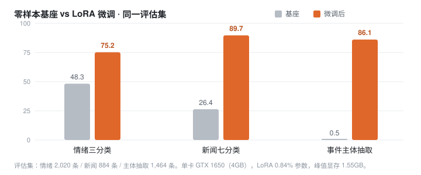

# FinCUGE-Tiny

把 Qwen3-0.6B 用 LoRA 微调，做三个中文金融任务：情绪三分类、新闻七分类、从新闻里抽事件主体。

训练全部在一块 GTX 1650（4GB）上完成，每个任务训一轮，峰值显存 1.55GB，单任务不超过 3 小时。

  



数据来自 FinCUGE 的指令化版本。三个任务都在全量评估集上评测，基座用同一套判分代码跑同一批样本，所以可以直接对比。

## 更新

- **2026-10-29** 三个任务跑完；补上 agent harness（路由 + 校验 + 拒答）。主体抽取 1,464 条测试里没有一次编造公司名。
- **2026-10-28** 情绪用 16,157 条全量重训，2,020 条评估集上 75.2%。
- **2026-10-27** 新闻七分类 89.7%，零样本基座 26.4%。

## 结果

| 任务     | 指标       | 基座（零样本） | 微调后      | 提升    | 评估集   | 训练时长    |
| ------ | -------- | ------- | -------- | ----- | ----- | ------- |
| 情绪三分类  | Accuracy | 48.3    | **75.2** | +26.9 | 2,020 | 169 min |
| 新闻七分类  | Accuracy | 26.4    | **89.7** | +63.3 | 884   | 179 min |
| 事件主体抽取 | 实体严格匹配   | 0.5     | **86.1** | +85.6 | 1,464 | 190 min |

新闻分类的准确率是零样本基座的 3.4 倍。三项指标的口径与公开论文不同（数据版本、训练方式都不一样），所以没有跟论文数字横比。

## 和公开报告的对照

同样是 FinESE 事件主体抽取，公开报告里有这些数字（ORMACC / 正则匹配准确率，越高越好）：

| 模型 | 参数 | 训练方式 | FinESE | 出处 |
|---|---|---|---|---|
| Touchstone-GPT | 7B | 金融语料预训练 + 指令微调 | 90.7 | Golden Touchstone（作者自研，自报） |
| **本项目** | **0.6B** | **LoRA 微调，4GB 显卡** | **86.1** | 本仓库 1,464 条 |
| GPT-4o | 未公开 | 零样本 | 68.7 | Golden Touchstone |
| DISC-FinLLM | 13B | 金融指令微调 | 43.5 | Golden Touchstone |
| CFGPT1-7B | 7B | 金融继续预训练 | 38.6 | Golden Touchstone |
| Qwen2-7B-Instruct | 7B | 零样本 | 36.8 | Golden Touchstone |
| Llama-3-8B-Instruct | 8B | 零样本 | 30.9 | Golden Touchstone |

这不是同一场考试：公开报告用的是 1,782 条原始测试集和各自的提示词协议，本项目用的是 1,464 条转换版数据，其余模型也没有在这份数据上微调过。数字并排只作量级参考。

能确定的是：把参数量压到 0.6B、显存压到 4GB、训练 3 小时，这个任务上的表现进入了 7B 级金融专用模型的区间。

## 安装

```
pip install -r requirements.txt
```

torch 要按本机 CUDA 版本装，例如 `pip install torch==2.7.1 --index-url https://download.pytorch.org/whl/cu118`。

## 快速开始

数据就在仓库里，以情绪任务为例，两条命令跑完训练和评估：

```
python train_sft.py --data_path data/fincuge/emotion_train.json --num_samples 16157 \
  --seq_len 128 --batch_size 2 --grad_accum 4 --epochs 1 --fast_loss 1 \
  --out out/adapter-emotion
python eval_verbalizer.py --limit 0 --adapter out/adapter-emotion --batch 4
```

在 4GB 卡上，训练大约 2 小时 50 分，评估 8 分钟。训练结束会得到三个目录：`out/adapter-emotion` 是最后一轮，`out/adapter-emotion_best` 是验证集上最好的那一轮，`out/adapter-emotion_ckpt` 是中途断点。

另外两个任务把数据换掉、评估脚本换掉就行，命令在下面各自的段落里。

## 数据

`data/fincuge/` 下共约 15MB，已经转成 alpaca 三字段格式，clone 下来可以直接训，不用另外下载数据集。

| 任务 | 训练集 | 评估集 | 数据文件 |
|---|---|---|---|
| 情绪三分类 | 16,157 | 2,020 | `emotion_train.json` / `emotion_eval.json` |
| 情绪（Verbalizer 版） | 16,157 | 2,020 | `emotion_vb_train.json` / `emotion_vb_eval.json` |
| 新闻七分类 | 7,071 | 884 | `newscat7_train.json` / `newscat7_eval.json` |
| 事件主体抽取 | 11,752 | 1,464 | `entity_train.json` / `entity_eval.json` |

```json
{
  "instruction": "判断以下句子的情感属性。",
  "input": "该公司一季度净利润同比增长三成。",
  "output": "积极"
}
```

这些文件由 FinCUGE 原始数据转换而来，版权归 BBT-Fin / FinCUGE 原项目，放在这里只为便于复现，请遵循原项目许可，勿作商用。需要从原始数据重做时再执行 `prepare_fincuge.py` 和 `prepare_newscat7.py`。

## 三个任务

### 情绪三分类

训练 16,157 条，评估 2,020 条（积极 886 / 消极 574 / 中性 560）。

|                                                                                                                              |                                                 |
| ---------------------------------------------------------------------------------------------------------------------------- | ----------------------------------------------- |
| 这份数据的答案有 15 种句式（"积极。"、"该文本情感是积极的。"……），生成文本再解析容易踩格式的坑。这里改成直接读三个标签 token 的概率：一次前向拿到 P(积极)、P(消极)、P(中)，再把"中"接到输入末尾补一次得到 P(性 | 中)，两者相乘就是 P(中性)，最后在三类内归一化。评估只要一次前向，置信度也顺便有了。 |

```
python train_sft.py --data_path data/fincuge/emotion_train.json --num_samples 16157 \
  --seq_len 128 --batch_size 2 --grad_accum 4 --epochs 1 --fast_loss 1 \
  --out out/adapter-emotion
python eval_verbalizer.py --limit 0 --adapter out/adapter-emotion --batch 4
```

另外做了一个对照：把答案压成只剩"积极/消极/中性"再训一版（`emotion_vb_train.json`），得 76.3%，只高 1.1 个百分点，在噪声范围内。瓶颈不在答案格式。

### 新闻七分类

训练 7,071 条，评估 884 条。

原始 FinCUGE 是 15 类，这里用 `prepare_newscat7.py` 并成 7 类：公司、新冠、经济、行业、大盘、政策、其它。生成式输出，答案解析时按类别词的别名匹配（"个股"算公司，"疫情"算新冠）。

```
python prepare_newscat7.py
python train_sft.py --data_path data/fincuge/newscat7_train.json --num_samples 7071 \
  --seq_len 512 --batch_size 2 --grad_accum 4 --epochs 1 --fast_loss 1 \
  --out out/adapter-newscat
python eval_multi.py --task newscat7 --adapter out/adapter-newscat
```

### 事件主体抽取

训练 11,752 条，评估 1,464 条。

这是生成任务：答案是一句话加一个主体（"所属信批违规事件的金融主体是××。"），训练集有 103 种模板。评估时从生成文本里抽出主体（规则是取最后一个"是"或"："之后的内容、去标点），再跟金标比实体。

```
python train_sft.py --data_path data/fincuge/entity_train.json --num_samples 11752 \
  --seq_len 320 --batch_size 2 --grad_accum 4 --epochs 1 --fast_loss 1 \
  --out out/adapter-entity --val_metric entity --val_limit 200
python eval_entity.py --adapter out/adapter-entity
```

严格匹配 86.1%，宽松匹配 89.2%（允许"雅虎"对"雅虎公司"），实体级 P/R/F1 都是 0.861。203 条错例里，78% 是原文里有好几个公司名、挑中了错的那个，22% 是多一个字少一个字（`科融环境` 抽成 `万科融环境`）。

1,464 条测试里，模型预测的主体全部出现在原文中，没有一条是编造的。

## Agent harness

三个 adapter 可以挂在同一个基座上，由一个外壳调度：判断该用哪个技能，按固定模板调用，校验输出，没把握就说不知道。

```
输入 → 清洗 → 路由 → 技能执行 → 校验 → 三档判定 → 输出
                     ↑               ↓
                     └─── 重试（最多 2 次）───┘
```

```python
from harness import Harness

h = Harness()
h.answer("这家公司业绩暴雷，投资者情绪一片悲观")
# {'task': 'emotion', 'answer': '消极', 'confidence': 0.922,
#  'decision': 'auto', 'flags': [], 'latency_ms': 1047}
```

三个 adapter 同时驻留（每个 LoRA 约 10MB），切换不重载。端到端延迟：情绪约 1.0s、新闻约 0.8s、主体抽取约 1.2~1.4s。

| decision  | 含义      | 触发条件             |
| --------- | ------- | ---------------- |
| `auto`    | 直接采用    | 校验通过且置信度 ≥ 阈值    |
| `hint`    | 给出但标注存疑 | 置信度中等，或存在非致命瑕疵   |
| `abstain` | 拒答并说明原因 | 标签非法、实体为空、实体不在原文 |

每次调用写一行日志到 `logs/harness_trace.jsonl`，含路由依据、置信度、决策、flags、耗时。设计细节见 [AGENT\_HARNESS.md](AGENT_HARNESS.md)。

## 为什么能塞进 4GB

三件事一起做才够：

| 手段                | 效果                              |
| ----------------- | ------------------------------- |
| 只对答案 token 算 loss | lm_head 不再输出整段序列，省约 600MB       |
| LoRA r=8，挂 7 个模块  | 可训练参数 0.84%，优化器状态只占几 MB         |
| 序列长度按数据 P99 定     | 主体抽取 P99 只有 201 token，不必按 512 跑 |

配合 batch 2、梯度累积 4、梯度检查点，稳定跑在 1.55GB。实现上主要在 `train_sft.py` 的 `answer_only_loss()` 和 `--fast_loss` 开关。

## Roadmap

- [ ] 把三个 adapter 打包成 GitHub Release 附件（共约 60MB），下载即用，不必重训
- [ ] 新闻任务改受限 softmax：只读 7 个标签 token 的概率，比生成式快，且能直接得到置信度
- [x] harness 的阈值在回归集上标定（情绪 2,020 / 新闻 884 / 主体 1,464 条）
- [ ] 批量推理接口：同一批请求按任务分组，减少 adapter 切换
- [ ] 补 FinESE 官方测试集（1,782 条），本项目用的是 1,464 条

## 引用

```bibtex
@article{lu2023bbt,
  title={BBT-Fin: Comprehensive Construction of Chinese Financial Domain Pre-trained Language Model, Corpus and Benchmark},
  author={Lu, Dakuan and Wu, Hengkui and Liang, Jiaqing and Xu, Yipei and He, Qianyu and Geng, Yipeng and Han, Mengkun and Xin, Yingsi and Xiao, Yanghua},
  journal={arXiv preprint arXiv:2302.09432},
  year={2023}
}

@article{yang2023fingpt,
  title={FinGPT: Open-Source Financial Large Language Models},
  author={Yang, Hongyang and Liu, Xiao-Yang and Wang, Christina Dan},
  journal={arXiv preprint arXiv:2306.06031},
  year={2023}
}
```

## 许可

代码 MIT，见 [LICENSE](LICENSE)。

`data/fincuge/` 下的数据由 FinCUGE 原始数据转换而来，版权归 BBT-Fin / FinCUGE 原项目所有，放在仓库里只为便于复现，请遵循原项目许可，勿作商用。如果原作者认为不妥，可以提 issue，会立即移除。

基线模型 Qwen3-0.6B 遵循其自身许可。
